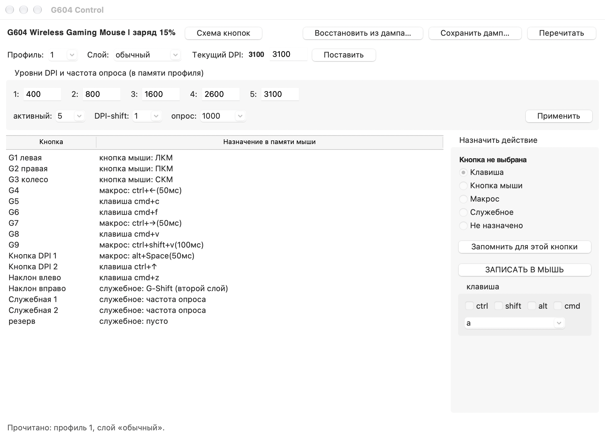
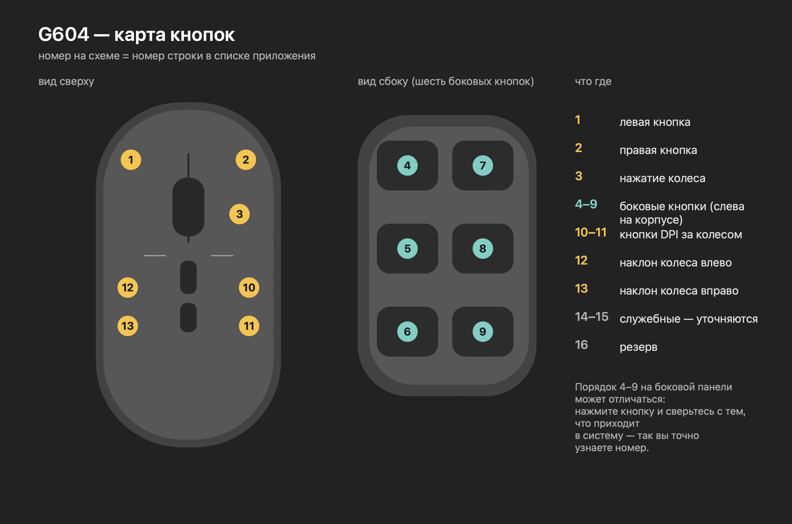

# G604 Control

**Замена Logitech G HUB для мыши Logitech G604 на macOS.** Работает с памятью мыши напрямую
по протоколу HID++ 2.0 — без G HUB, без сети, без аккаунтов и без проверок обновлений.

[](https://github.com/derangedabbot/g604-control)
[](https://www.python.org)
[](https://docs.python.org/3/library/tkinter.html)
[](https://github.com/derangedabbot/g604-control)
[](https://github.com/derangedabbot/g604-control/releases)



## Содержание

- [Зачем](#зачем)
- [Установка](#установка)
- [Как пользоваться](#как-пользоваться)
- [Схема кнопок](#схема-кнопок)
- [Особенности мыши, о которых надо знать](#особенности-мыши-о-которых-надо-знать)
- [Формат памяти](#формат-памяти)
- [Состав проекта](#состав-проекта)
- [Сборка из исходников](#сборка-из-исходников)

## Зачем

G HUB весит как небольшая игра, требует аккаунт, тянет телеметрию и периодически ломается
на проверке обновлений — вплоть до чёрного экрана при запуске. При этом все настройки G604
хранятся **в самой мыши**: программа нужна только чтобы туда их записать.

Это приложение делает ровно это — читает и пишет память мыши, без фоновых служб и без сети.
После записи настройки работают на любом компьютере: мышь самодостаточна.

## Установка

**Готовое приложение.** Скачать архив из [Releases](https://github.com/derangedabbot/g604-control/releases),
распаковать, перетащить `G604 Control.app` в «Программы».

Ничего доустанавливать не нужно: Python, Tk и hidapi уже внутри (31 МБ).

Первый запуск: приложение без подписи разработчика, поэтому macOS может попросить
подтверждение — правый клик по приложению → **«Открыть»** → «Открыть» ещё раз.

Перед первым запуском приёмник должен быть в USB, а мышь — не спать (пошевелить её).
Если написано «мышь не найдена» — нажать «Перечитать».

## Как пользоваться

| Что сделать | Где |
|---|---|
| Прочитать настройки из мыши | кнопка «Перечитать» |
| Сменить профиль или слой | селекторы «Профиль» и «Слой» под заголовком |
| Назначить действие кнопке | выбрать строку → выбрать тип справа → «Запомнить для этой кнопки» |
| Собрать макрос | тип «Макрос» → «Изменить макрос…» → шаги → «Сохранить в кнопку» |
| Поменять уровни DPI и частоту опроса | блок «Уровни DPI и частота опроса» → «Применить» |
| Записать всё в мышь | «ЗАПИСАТЬ В МЫШЬ» (бэкап делается автоматически) |
| Откатить настройки | «Восстановить из дампа…» или файл из `backups/` |

Типы действий: **клавиша** с модификаторами, **кнопка мыши**, **макрос**,
**служебное** (DPI вниз/вверх/переключение, смена профиля, G-Shift), **не назначено**.

Слой **G-Shift** — второй набор назначений: работает, пока зажата кнопка, которой назначено
служебное действие «G-Shift». Отпустили — снова обычный слой.

## Схема кнопок

Номера на схеме совпадают с номерами строк в приложении. Кнопка «Схема кнопок» открывает её
прямо в программе.



## Особенности мыши, о которых надо знать

- **Любая запись в память профиля сбрасывает текущий DPI на первый уровень.** Приложение само
  возвращает активный уровень после записи — это сделано специально, не баг.
- Мышь засыпает при простое: HID++ перестаёт отвечать, помогает движение мышью.
- Устройство открывается эксклюзивно: пока приложение запущено, другие программы к мыши
  не подключатся.
- Конфигурация живёт в памяти мыши, а не в файле на диске. Файл нужен только для бэкапа.

## Формат памяти

Профиль занимает сектор 255 байт. Раскладка сверена с [libratbag](https://github.com/libratbag/libratbag)
и проверена на живой мыши.

| Смещение | Поле |
|---|---|
| 0 | частота опроса: байт = 1000/Гц (1 = 1000, 2 = 500, 4 = 250, 8 = 125) |
| 1 | активный уровень DPI (0–4) |
| 2 | уровень DPI-shift (0–4) |
| 3–12 | пять уровней DPI, uint16 little-endian |
| 32–95 | кнопки обычного слоя: 16 записей по 4 байта |
| 96–159 | кнопки слоя G-Shift: 16 записей по 4 байта |
| 160 | имя профиля (UTF-16LE) |

Запись кнопки — 4 байта:

| Байты | Смысл |
|---|---|
| `80 01 00 маска` | кнопка мыши (1, 2, 4, 8, 16) |
| `80 02 моды HID-код` | клавиша: модификаторы `01` ctrl, `02` shift, `04` alt, `08` cmd |
| `00 06 00 смещение` | макрос в секторе 6 |
| `90 код 00 00` | служебное: `07` не назначено, `04` DPI вниз, `03` DPI вверх, `01` переключение DPI, `02` смена профиля, `0B` G-Shift |

Макросы лежат в секторе 6: шаг — 6 байт `[43 нажать | 44 отпустить][модификаторы][HID-код][40][пауза]`,
конец макроса — `FF`.

## Состав проекта

| Файл | Назначение |
|---|---|
| `g604_editor.py` | приложение (Tkinter) |
| `hidpp_g604.py` | транспорт HID++: чтение и запись секторов памяти, CRC |
| `macros.py` | формат макросов: разбор и сборка |
| `diagram.png`, `draw_diagram.swift` | схема кнопок и её исходник |
| `decode_memory.py` | консольный разбор дампа памяти |
| `set_entry.py` | правка одной кнопки в дампе |
| `backups/` | дампы памяти и авто-бэкапы перед записью |
| `dev/` | черновики: прослушка событий, тесты, старые варианты |
| `build.sh`, `G604 Control.spec` | сборка .app через PyInstaller |

## Сборка из исходников

Нужны Python 3.14 с Tk (`/usr/local/bin/python3`) и hidapi (`brew install hidapi`):

```bash
./build.sh
```

Скрипт создаёт виртуальное окружение, ставит PyInstaller и собирает `G604 Control.app`
с иконкой, схемой и библиотекой hidapi внутри.

---

Проект личный, сделан под конкретную мышь и macOS. Формат памяти разобран экспериментально;
перед экспериментами с записью всегда делайте дамп — приложение сохраняет его автоматически.
